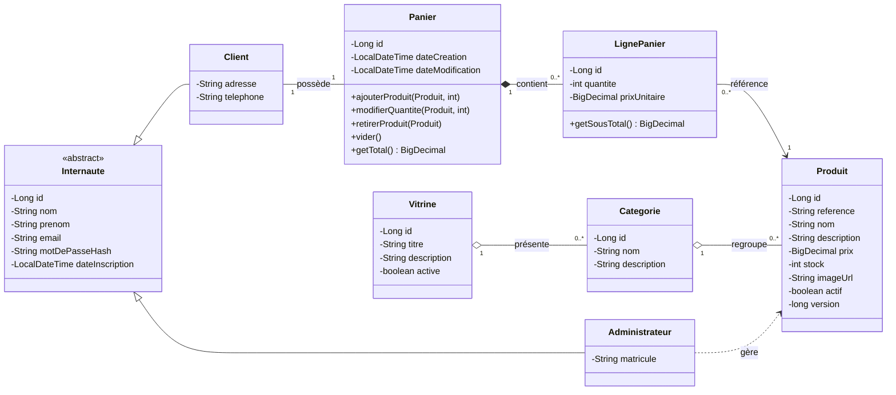

# Diagramme de classes : version A (panier, vitrine, internaute)

## Lecture rapide des relations

| Relation | Type JPA | Cascade / remarque |
|---|---|---|
| `Internaute` → `Client`, `Administrateur` | `@Inheritance(SINGLE_TABLE)` | Colonne discriminante `TYPE_INTERNAUTE` |
| `Client` 1—1 `Panier` | `@OneToOne` | Le client est le côté propriétaire (`panier_id`), `CascadeType.ALL` |
| `Panier` 1—* `LignePanier` | `@OneToMany(mappedBy = "panier")` | `CascadeType.ALL` + `orphanRemoval = true` |
| `LignePanier` *—1 `Produit` | `@ManyToOne` | Pas de cascade : un produit survit à la ligne |
| `Vitrine` 1—* `Categorie` | `@OneToMany` / `@ManyToOne` | Pas de suppression en cascade des catégories |
| `Categorie` 1—* `Produit` | `@OneToMany` / `@ManyToOne` | Idem |
| `Administrateur` → `Produit` | Dépendance (aucune association persistée) | Représente le droit de gérer le catalogue |
